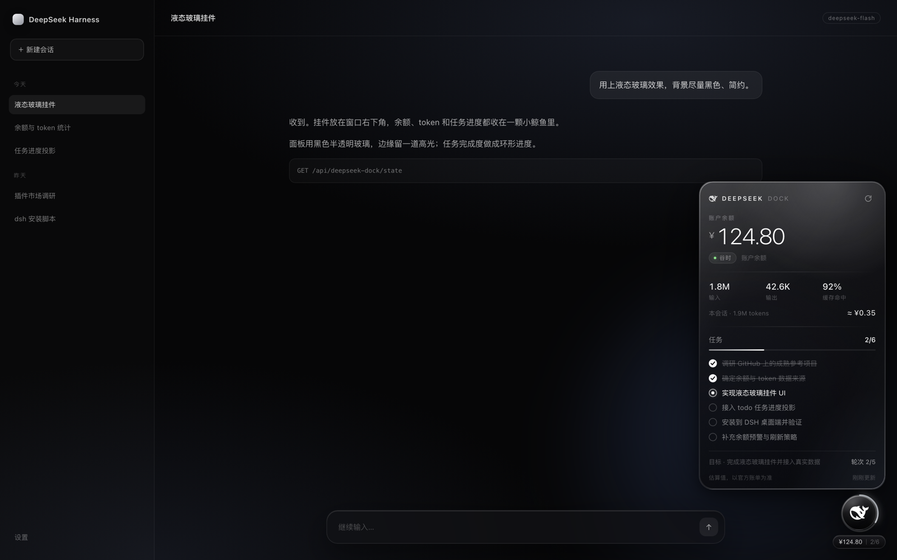

# dsh-deepseek-dock

DSH 右下角的液态玻璃小鲸鱼挂件：**账户余额 + 本会话 token / 估算费用 + 任务完成度**。



> 交互预览：[preview.html](preview.html)（假数据，可直接在浏览器打开）

## 功能

- 右下角常驻 56px 小鲸鱼图标，外圈是任务完成度环形进度。
- 图标下方的小药丸常显余额；悬停/展开时追加 `完成/总数`。
- 点击展开黑色液态玻璃面板：
  - 账户余额（CNY/USD），低于 ¥5 变琥珀色、低于 ¥1 变红色
  - 本会话输入 / 输出 / 缓存命中 token
  - 本会话估算费用（按 DeepSeek 峰谷价、Flash 价目）
  - 任务清单 `x/y` + 进度条 + 每条状态
  - 当前 goal 的轮次（有 goal 时）
- 每 60 秒刷新余额；打开面板时 30 秒刷新。支持手动刷新、Escape / 点外部关闭。
- 指针跟随的镜面高光、42px 背景模糊、黑色半透明底、极简单色排版。
- 尊重 `prefers-reduced-motion`。

## 数据来源

| 数据 | 来源 | 说明 |
| --- | --- | --- |
| 余额 | 宿主 `deepseekAccount.getBalance()` | 已登录 DeepSeek 账户时不需要 API key |
| 余额兜底 | `GET https://api.deepseek.com/user/balance` | 通过 DSH credentials 读 `DEEPSEEK_API_KEY` |
| token | 客户端 `tokenUsage` 会话投影 | 实时，provider usage 原值 |
| 费用 | 客户端按 token × 价目表估算 | 峰谷价，Flash 价；不是官方账单 |
| 任务 | 客户端 `todos` 会话投影 | 只显示当前回合的 todo 清单 |
| 目标 | 客户端 `goal` 会话投影 | 显示 `roundsStarted / maxGoalRounds` |

> `todos` 投影会在下一轮 `turn/start` 时清空，这是 DSH 的既有语义；回合结束后清单会保留到下一轮开始。

## 安装

### 桌面端 / Web profile

```sh
git clone https://github.com/mipo227/dsh-deepseek-dock.git
cp -R dsh-deepseek-dock ~/.dsh/profiles/desktop/node_modules/
```

在 `~/.dsh/profiles/desktop/cordis.patch.yml` 末尾追加：

```yaml
# dsh-deepseek-dock: 右下角液态玻璃挂件
- insert:
    - id: deepseek-dock
      name: dsh-deepseek-dock
```

重启 DSH。桌面端不能热加载 profile；Web 版刷新页面即可。

> 为什么用 patch 而不是 `package.json` 的 `bundles`：桌面端 profile 由 Electron 应用管理，`cordis.patch.yml` 是用户 patch 层，改它不会和应用管理的 `package.json` 打架。同样的方式已在 web profile 验证。

### 卸载

删除 profile `cordis.patch.yml` 里的 `insert` 块，并删除 `node_modules/dsh-deepseek-dock`，重启即可。

## 配置（可选）

在 profile patch 的 insert 行上直接写 `config`：

```yaml
- insert:
    - id: deepseek-dock
      name: dsh-deepseek-dock
      config:
        balanceBaseURL: https://api.deepseek.com
        balanceApiKeyEnv: DEEPSEEK_API_KEY
        lowThreshold: 5
        criticalThreshold: 1
```

## 兼容性

- DeepSeek Harness 0.2.2-rc.5（桌面端 / web profile）
- 桌面端宿主为 macOS；Web 版跨平台
- 宿主只用了 Node 内置的 `fetch` / `BigInt`，不需要额外依赖

## 限制

- 费用是估算值，按 Flash 峰谷价计算；Pro 或自定义单价不会自动切换。
- `todos` 只反映当前回合的清单，不是跨回合的项目管理。
- 余额读取失败时显示上次成功值（10 分钟内），不会把网络错误当成 0。
- 节假日表是 2026 年国务院安排；2027 年需要更新 `CN_HOLIDAYS_2026`。
- 未登录 DeepSeek 账户且没有 `DEEPSEEK_API_KEY` 时，余额显示 `—`，token / 任务仍正常工作。

## 开发

```sh
node build.mjs   # 生成 lib/client.js 与 preview.html
```

源文件在 `src/`：`style.css`、`client.js`（含 `__CSS__` / `__WHALE__` 占位符）、`preview.html`、`whale.svg`。

## 参考

- [DeepSeek-Balance-Whale-Widget](https://github.com/xiaolinnnnnnn/DeepSeek-Balance-Whale-Widget)：右下角鲸鱼、余额差记账、峰谷价
- [dsh-balance-widget](https://github.com/LL-cmyk-so/dsh-balance-widget)：账户服务取余额、host route + 客户端 slot 的架构
- [dsh-cost-gauge](https://github.com/wjingshan/dsh-cost-gauge)：浮动窗、贴边吸附、Electron 拖动热区处理
- [ccusage](https://github.com/ccusage/ccusage)：token / 成本口径参考

## License

MIT
