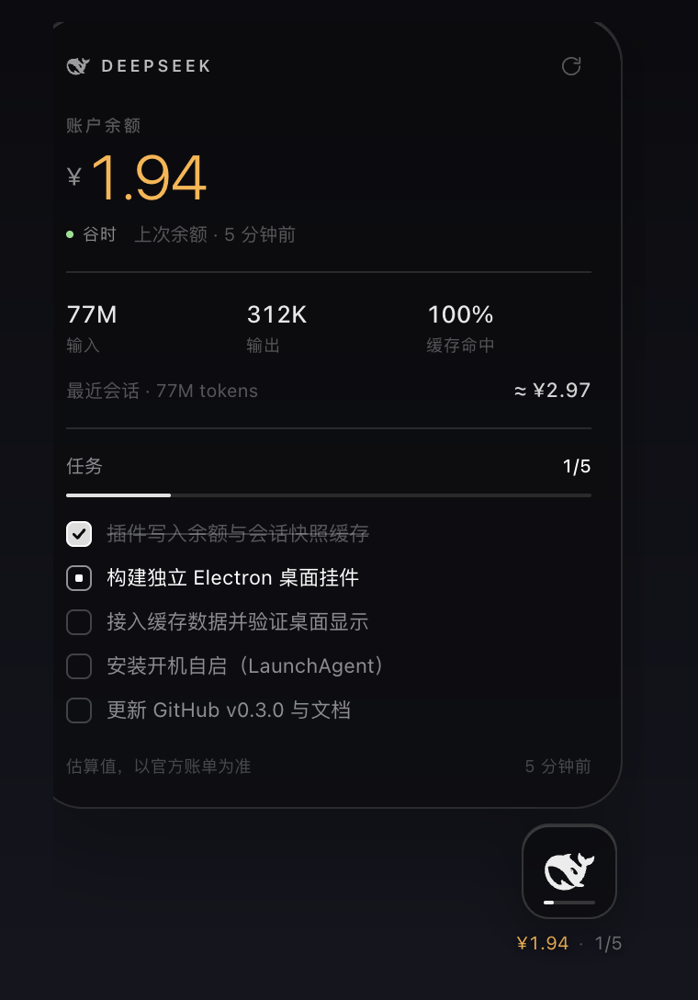

# dsh-deepseek-dock desktop

把同一个挂件做成**独立运行的 macOS 桌面进程**：固定在桌面右下角，始终置顶；**DeepSeek Harness 关闭后仍然显示**。



## 工作方式

DSH 插件会把数据写到：

- `~/.dsh/deepseek-dock/state.json` — 余额、峰谷价、阈值（DSH 运行时每 5 分钟暖刷新，客户端请求时也会更新）
- `~/.dsh/deepseek-dock/session.json` — 最近会话的 `todos` / `tokenUsage` / `goal` 快照

桌面进程只读这两个文件，**不依赖 DSH 进程**：

| DSH 状态 | 余额 | token / 任务 |
| --- | --- | --- |
| 运行中 | 缓存值（通常 1 分钟内） | 最近一次客户端快照 |
| 已关闭 | 上次余额；超过 2 分钟显示「上次余额 · X 分钟前」 | 关闭前的最后快照 |

> 余额不是实时查询。要 DSH 关闭后仍实时查余额，需要单独存 API key；当前版本刻意不这么做。

## 启动

```sh
cd desktop
ELECTRON_MIRROR=https://npmmirror.com/mirrors/electron/ npm install
npm start
```

- 无 Dock 图标；菜单栏会出现小鲸鱼图标。
- 窗口固定在桌面右下角，`alwaysOnTop`，所有 Space / 全屏应用上可见。
- 点击图标展开卡片；窗口高度按卡片收缩，不会挡住大片桌面。
- 首次运行自动创建 `~/Library/LaunchAgents/com.mipo227.dsh-deepseek-dock.plist`，登录时自启。
- 菜单栏菜单：显示/隐藏、刷新、始终置顶、开机自启、退出。

## 首次数据

先让 DSH 跑一次并打开任意会话，让插件写入两个缓存文件；否则桌面挂件会显示「等待 DSH 同步」。

## 注意

- 这是开发版 Electron 应用，LaunchAgent 指向 `<repo>/desktop`；移动目录后重新 `npm start` 或在菜单里关掉再打开「开机自启」。
- macOS only（Electron 45 arm64）。
- 退出：菜单栏鲸鱼图标 → 退出。关闭窗口不会退出进程。
- 如果不需要开机自启：菜单栏 → 开机自启（取消勾选）。

## 文件

- `main.js` — Electron 主进程、窗口、托盘、LaunchAgent
- `data.js` — 读取两个缓存文件并计算 token / 费用
- `renderer.js` — 挂件 UI
- `ui.template.html` + `index.html` — 生成后的页面
- `build-ui.mjs` — 把 `../src/style.css` 和鲸鱼 SVG 注入页面

## License

MIT
